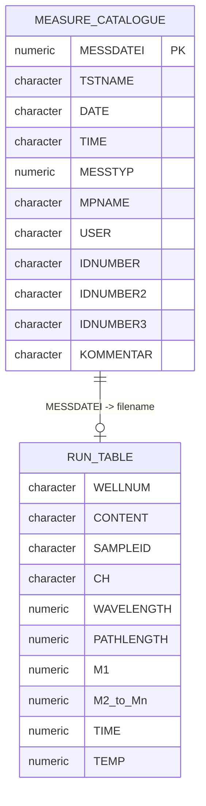

# OMEGA database structure

This document describes the database layout observed in the FLUOstar OMEGA database used to develop this exporter. It is based on DBF headers and behavior observed during development; it is not an official BMG LABTECH specification. Field presence and meaning can vary with instrument firmware, software version, measurement mode, and protocol.

## Directory layout

The exporter searches for a directory containing `Measure.dbf`, normally:

```text
BMG/
└── Omega/
    └── User/
        └── Data/
            ├── Measure.dbf
            ├── Measure.DBT
            ├── 1.dbf
            ├── 2.dbf
            ├── ...
            └── <run-id>.dbf
```

`Measure.dbf` is the run catalogue. Each active catalogue record describes one plate-reader run. Its numeric `MESSDATEI` value identifies the corresponding numbered measurement table:

```text
Measure.dbf record
    MESSDATEI = <run-id>
          │
          └──────────────► <run-id>.dbf
```

`Measure.DBT` is the dBASE memo sidecar used by memo fields in the catalogue. The exporter reads catalogue fields stored directly in `Measure.dbf`; it does not interpret MARS analysis objects stored in memo blocks.

An indexed run can occasionally have no matching numbered DBF. The UI lists it as **Data file missing**, and exporting that run fails without stopping the rest of a batch.

## File relationship



The relationship is logical rather than a declared database constraint. DBF files do not provide foreign keys.

## DBF representation

The files use the dBASE record model:

- A 32-byte file header contains the record count, header length, record length, and language-driver byte. It is followed by one 32-byte descriptor per field and a header terminator.
- Records are fixed-width byte sequences. Numeric values are stored as right-aligned text, not binary floating-point numbers.
- The first byte of every record is a deletion marker. A space means active; `*` means deleted. The exporter skips deleted records.
- Character fields in the supported installations use a Windows Western encoding compatible with Windows-1252. The exporter converts them to UTF-8.
- Supported field types are `C` (character), `N`/`F` (numeric), `L` (logical), `D` (date), and `M` (memo pointer). Numbered measurement tables containing memo fields are rejected.

The reader validates record sizes and field descriptors before parsing. It also checks the file size and modification time again after reading, which detects changes that alter either attribute. These checks do not provide a database snapshot or guarantee consistency while the instrument is writing.

## `Measure.dbf`: run catalogue

The catalogue has many protocol and instrument-setting fields. Only a small stable subset is required to locate and describe exports.

| Field | Role in the exporter |
|---|---|
| `MESSDATEI` | Numeric run identifier and numbered DBF filename stem. |
| `TSTNAME` | Protocol name; used in the output filename. |
| `DATE`, `TIME` | Recorded run date and time. Dates accept `YYYY-MM-DD`, `YYYY/MM/DD`, `YYYY.MM.DD`, or the DBF date form `YYYYMMDD`; times use `HH:MM:SS`. Invalid calendar dates are rejected. |
| `MESSTYP` | Numeric measurement-mode code. |
| `MPNAME` | Plate definition/name. |
| `USER` | Stored instrument user. |
| `IDNUMBER` | Run comment shown as ID1. |
| `IDNUMBER2` | Run comment shown as ID2. |
| `IDNUMBER3` | Run comment shown as ID3. |
| `KOMMENTAR` | Protocol comment. |

Observed `MESSTYP` values used by the UI are:

| Value | Displayed technique |
|---:|---|
| 0 | FI |
| 1 | Absorbance |
| 2 | FP |
| 3 | Luminescence |
| 4 | Dual luminescence |
| 5 | Dual FI |
| 6 | TRF (2 channels) |
| 7 | AlphaScreen |
| 8 | TRF |
| 11 | Absorbance spectrum |
| 12 | Nephelometry |

Unknown values remain visible as `Mode <value>`. These labels are the exporter's mapping of observed codes, rather than a complete vendor specification.

Other catalogue groups include filter and gain settings, kinetic timing, shaking, injection/pump configuration, plate geometry, temperature targets, reader identity, firmware version, calibration values, and memo references. They are retained only while the run index is in memory and are not copied wholesale into the compact export.

## Numbered DBFs: measurement tables

Numbered tables vary by measurement mode. The exporter discovers columns from each DBF header instead of assuming one fixed schema.

| Field or pattern | Observed role |
|---|---|
| `WELLNUM` | Plate-well identifier such as `A01`; non-well tokens can identify calibration or technical rows. |
| `CONTENT` | Short content/well label. |
| `SAMPLEID` | Optional, longer sample identifier. It takes precedence over `CONTENT` in the compact header. |
| `CH` | Channel or series identifier. Special technical records can use nonnumeric values. |
| `WAVELENGTH` | Optional wavelength axis for spectrum runs. |
| `PATHLENGTH` | Optional stored path-length value. |
| `M1`, `M2`, … | Measurement values or points, in physical DBF field order. |
| `M1_1`, `M1_2`, … | Alternate continuation naming observed in very long kinetic tables. |
| `TIME` | Stored time value; used as the row axis when repeated well/channel records indicate kinetics. |
| `TEMP` | Stored temperature value. |
| `KONZ_CHAR`, `KONZ_MANT` | Stored concentration components used by the vendor software. |
| `DILUTION` | Stored dilution value. |
| `VOLPUMP1`–`VOLPUMP4` | Stored pump-volume fields. |

Names beginning with `M` are treated as measurement fields only when they match `M<digits>` or `M<digits>_<digits>`. The physical field order defines their sequence.

## Plate rows and technical rows

A plate-well row has one or more uppercase ASCII letters followed by digits, for example `A01` or `AA01`. Rows whose `WELLNUM` does not match that form are treated as internal records. Observed internal rows include absorbance references such as `0ABS` and `1ABS`, timing rows, and temperature/helper rows.

The compact exporter keeps plate-well measurements and omits internal rows. This is the main difference between the compact output and a raw DBF dump.

## How tables become compact exports

The output begins with selected catalogue metadata. The numbered DBF is then pivoted according to its available axes:

| Detected layout | Export layout |
|---|---|
| `WAVELENGTH` plus one measurement field | One row per wavelength/channel; one column per well. |
| One measurement field with repeated well/channel pairs | One row per stored time/channel; one column per well. Duplicate cells are rejected, including duplicates whose first value is blank. |
| One measurement field without repeated pairs | One row per channel; one column per well. |
| Multiple measurement fields | One row per measurement point; one column per well/channel. A technical `CH = t` row supplies the time labels when present. |

In single-measurement-field layouts, duplicate wavelength/time/channel and well combinations are rejected rather than overwritten.

The measurement values are copied from the numbered DBF without recalculation. The exporter does not evaluate MARS curve fits, blank-subtraction workflows, memo objects, or other analysis definitions.

## Read-only and consistency behavior

The exporter never writes to the BMG directory. It opens each DBF for binary input, parses active records, and writes the result to the chosen output directory. The UI rejects the database folder itself as an output folder; choose a separate export location. If a run table is missing, truncated, unsupported, or changes while being read, that run fails with an error and the remaining selected runs continue.

